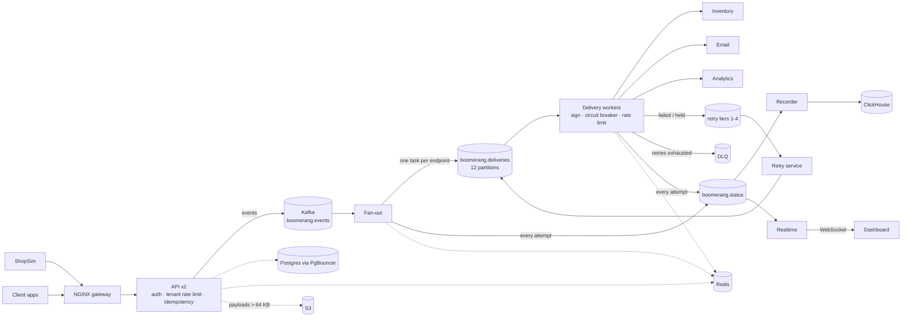

# Boomerang

A multi-tenant webhook delivery platform. Applications send events to Boomerang, and it gets them to every
subscriber's server, even when receivers are slow, flaky or offline: signed payloads, at-least-once
delivery, tiered retries, circuit breakers, per-endpoint rate limits, a dead-letter queue with replay,
and a live dashboard where you can watch it all happen.

It ships with **ShopSim**, a simulated store that generates realistic `order.*` and `payment.*` traffic,
and three mock receivers (Inventory, Email, Analytics) that you can break on purpose.

## Quick start

Requires Docker Desktop with about 4 GB of memory.

```bash
make up            # or: docker compose up -d --build
open http://localhost:8080
```

The first build takes a few minutes. Everything runs from one Compose file. Other useful commands:

| Command | What it does |
|---|---|
| `make obs` | Adds Prometheus (:9090), Grafana (:3000, "Boomerang" dashboard), Loki and Jaeger (:16686) |
| `make reset` | Deletes all data, for a fresh demo |
| `make chaos` | SIGKILLs a worker mid-burst and checks that no event was lost |
| `make loadtest` | k6 ramp to 2,000 events/s through the gateway |
| `make test` / `make test-integration` | Unit tests, and Testcontainers tests against real Kafka/Redis/Postgres |

## Architecture



**Request flow**

1. `POST /v1/events` → the gateway → an API replica.
2. The API authenticates the key (cached in memory and Redis, never hashed against the DB on the hot
   path), applies the tenant's token-bucket limit in Redis, and claims the `Idempotency-Key`.
3. It writes the event to Kafka (acks=all) and returns `202`. Large payloads go to S3 first, and Kafka
   carries only a reference.
4. **Fan-out** finds subscribed endpoints (wildcards like `order.*` supported) and emits one delivery task
   per endpoint. Delivery ids are deterministic, so re-running fan-out after a crash never creates a
   second delivery.
5. **Workers** consume tasks with one goroutine per partition, keep the same ordering key sequential,
   and only commit offsets once everything below them is finished.
6. Each delivery is signed (`Boomerang-Signature: v1,<HMAC-SHA256(id.timestamp.body)>`) and POSTed with
   a strict timeout. Redirects are never followed, and the destination IP is checked at connect time
   (SSRF protection).
7. Failures go to a **retry tier** topic with exponential backoff and jitter. After the final attempt
   they go to the **DLQ**, from where one click replays them.
8. Every attempt goes to a status stream. ClickHouse stores it for the Event Explorer, and the realtime
   service streams it to the dashboard.

### Reliability mechanisms

| Mechanism | How it works |
|---|---|
| At-least-once | The API acks only after Kafka has the event. Workers commit an offset only when every task below it is done and its outcome (success, retry or DLQ) is durably in Kafka. A killed worker's in-flight work is redelivered to the others. |
| Idempotency | `Idempotency-Key` per tenant in Redis (24h). Retried requests return the original event id. |
| Tiered retries | Four retry topics, bucketed by delay (≤15s, ≤2m, ≤10m, longer), each with its own consumer group, so each tier's depth is visible as Kafka lag. The per-tenant schedule defaults to 2s/5s/10s/20s in demo mode and 10s/1m/5m/30m otherwise. |
| Circuit breaker | Shared in Redis (Lua). It trips when the time-decayed failure rate is at least 50% with enough volume, or after consecutive failures on a quiet endpoint, so a merely flaky receiver doesn't trip it. While it is open, deliveries are held without spending retry attempts. One half-open probe tests recovery. |
| Rate limiting | Per-endpoint GCRA reservations in Redis, plus AIMD: the rate halves on timeouts, 429s and 503s and creeps back up on success. Per-tenant token buckets apply at ingestion. |
| Isolation | Per-endpoint concurrency slots per worker. Tasks for an endpoint that is actually slow are shunted to the retry tier so they don't hold up others. When the worker itself is the bottleneck, Kafka holds the backlog instead. |
| Holds vs throttling | Endpoint-caused holds (circuit open, paused) are dead-lettered after `DEFER_MAX_AGE` (10 min in demo mode, 72h otherwise). Boomerang's own throttling never kills a delivery. |
| Security | HMAC signatures with timestamps (5-minute replay window), dual signatures during secret rotation, signing secrets AES-GCM encrypted at rest, API keys stored only as SHA-256 hashes, SSRF checks at registration and at dial time. |

## The dashboard

| Page | What's live on it |
|---|---|
| **Overview** | Received/delivered/retrying/DLQ counters, throughput, success rate, p50/p95/p99, endpoint health, and the **integrity** panel (created = delivered + dead, confirmed by receivers, lost = 0) |
| **Live Event Flow** | Canvas animation of sampled events: fan-out to receivers, red failures boomeranging through the retry lane, amber holds, the DLQ bin. Click a dot for its history. |
| **Traffic Control** | ShopSim single event, steady stream, bursts (up to 50k) and a ramping load test with target vs achieved rate |
| **Chaos Playground** | Failure rate, delay and down per receiver, plus presets (email outage, slow inventory, flaky email, random failures, everything on fire) |
| **Endpoints** | Register (SSRF-checked), subscriptions, pause/resume, reveal and rotate secrets, health score, circuit state, adaptive rate, replay DLQ |
| **Event Explorer** | Search by type, state, endpoint, time and payload text. Each event's payload, signature and full attempt timeline (repeated holds collapsed), with replay. |
| **Infrastructure** | Workers and their partitions, consumer lag per partition (colored by owner), retry-tier and DLQ depth, component health, scale and SIGKILL buttons |
| **Settings** | API keys (shown once, stored hashed), tenant rate limits, retry policy editor |

## Demo script (5–7 minutes)

Run `make reset && make up` beforehand for a clean slate.

1. **Endpoints:** three receivers with their subscriptions (`order.*`, `payment.*` + `order.shipped`, `*`).
2. **Traffic Control → Send `order.created`**, then switch to **Live Flow**. The dot fans out to Inventory
   and Analytics only.
3. **Event Explorer:** open that event to see the payload, the signature header, and the receiver's
   response `"signature":"valid"`.
4. **Steady stream at 50/s**, then **Overview:** throughput, success rate and latency.
5. **Chaos → Email service outage**, then **Live Flow:** Email turns red, the circuit opens, and its
   deliveries are held in the retry lane while Inventory and Analytics keep flowing.
6. **Chaos → All healthy:** the circuit closes, the backlog drains, and **Overview → Integrity** shows
   0 lost.
7. **Chaos → Flaky email** (40% errors) for about a minute. A few deliveries fail 5 times and land in the
   DLQ. Open one in the **Event Explorer** and replay it, or use **Endpoints → Replay DLQ**.
8. **Traffic → Burst 50,000**, then **Infrastructure:** consumer lag climbs on 1 worker.
9. **Scale to 4:** partitions rebalance (bar colors change) and lag falls.
10. **Kill (SIGKILL)** a worker mid-burst: its partitions move to the survivors, and **Overview → Integrity**
    ends with created = delivered and lost = 0. Duplicates show up as at-least-once redelivery, which
    receivers dedupe on `Boomerang-Id`.

Demo mode (`DEMO_MODE=true`, the default in Compose) uses second-scale retry delays and a 10s circuit
cooldown so everything is visible on stage.

## Measured on a laptop

All of these numbers come from one MacBook running every service in Docker Desktop (8 vCPU, 4 GB
shared by around 20 containers), so they measure contention as much as capacity:

- **Ingestion:** k6 ramp to 2,000 events/s through NGINX to 2 API replicas, with 0% errors. Median
  latency is about 9 ms. Tail latency grows when the delivery backlog competes for the same CPUs.
- **Delivery:** one worker capped at 0.5 CPU sustains about 1,100–1,700 deliveries/s. Scaling to 4 workers
  drained a backlog of about 250k deliveries at 2,500–4,700/s.
- **Chaos:** SIGKILL of 1 of 3 workers during a 20k-event burst gave 45,011 deliveries created, 45,011
  delivered, 0 lost and 25 duplicates.
- **Load test:** 135k events became 298k deliveries, all delivered, with 0 dead letters.

## Tech stack

| Layer | Choice | Notes |
|---|---|---|
| Edge | NGINX | Load balancer and gateway: routing, body limits, per-IP connection limits, WebSocket upgrade, re-resolves API replicas. Key auth and tenant limits run in the API against Redis so they hold across replicas. Kong or Envoy can replace it. |
| Services | Go 1.24, one binary, roles `api fanout worker retry recorder realtime shopsim receivers init` | franz-go (Kafka), go-redis, pgx, coder/websocket, OpenTelemetry, Prometheus |
| Event log | Kafka 3.9 (KRaft) | |
| Hot state | Redis 7 | Idempotency, caches, rate limiters, circuit breakers, live counters, DLQ set |
| Config DB | Postgres 16 + PgBouncer (transaction pooling) | |
| Analytics | ClickHouse 24.8 | Events, delivery state (ReplacingMergeTree), attempts, async batched inserts |
| Payloads | S3 API (SeaweedFS in Compose) | MinIO's images are no longer published on Docker Hub. The code uses the plain S3 API through `minio-go`, so any S3 works. |
| Dashboard | React 18 + TypeScript + Vite, Recharts, a hand-written canvas flow | |
| Observability | Prometheus (+ alert rules), Grafana, Loki + Promtail, Jaeger (OTLP) | `make obs` |
| Deploy | Docker Compose, Helm chart with KEDA lag-based worker autoscaling, HPA for the API, RBAC for the dashboard scaler | `deploy/helm/boomerang` |

## Repository layout

```
backend/            Go services (cmd/boomerang + internal/*), unit and integration tests
web/                React dashboard
deploy/nginx        gateway config
deploy/helm         Kubernetes chart (KEDA ScaledObject, HPA, PDB, RBAC, init Job, Ingress)
deploy/{prometheus,grafana,loki,promtail,clickhouse,pgbouncer,seaweedfs}
docs/API.md         REST + WebSocket contract and webhook format
loadtest/k6         k6 ingestion load test
scripts/            chaos-kill-worker.sh
```

## Kubernetes

```bash
docker build -t <registry>/boomerang-backend:0.1.0 backend && docker build -t <registry>/boomerang-web:0.1.0 web
helm install boomerang deploy/helm/boomerang -n boomerang --create-namespace \
  --set image.backend=<registry>/boomerang-backend:0.1.0 --set image.web=<registry>/boomerang-web:0.1.0 \
  --set external.kafkaBrokers=... --set external.redisAddr=... # etc, see values.yaml
```

Kafka, Redis, Postgres, ClickHouse and S3 are external (for example Strimzi or the community charts).
Workers scale with KEDA on the `boomerang-delivery` consumer lag, up to the partition count.

## Known limitations

- The dashboard and management API have no authentication; they are meant for a demo network. Put them
  behind SSO before exposing them.
- Ordering is preserved per endpoint and ordering key on first attempts. Retries are out of band, as with
  most webhook providers.
- The `api` container mounts the Docker socket (as root) so the dashboard can scale and kill workers.
  Remove the mount and `SCALER` to run it unprivileged.
